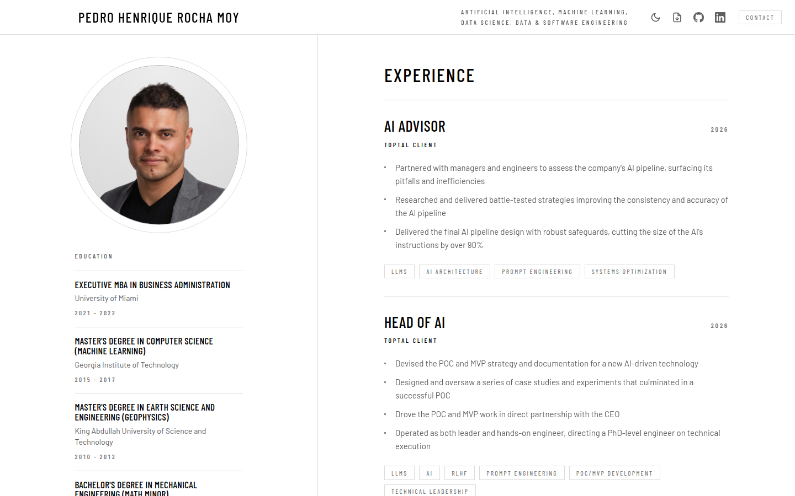
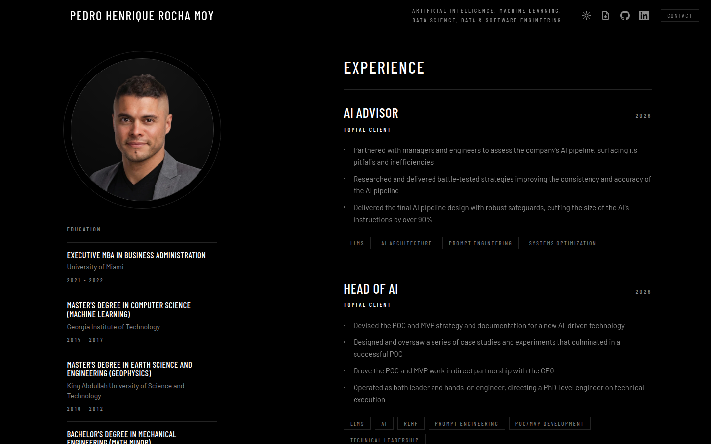
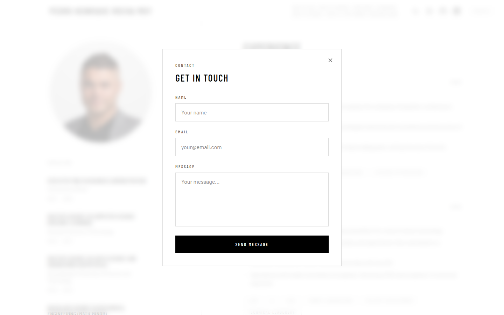
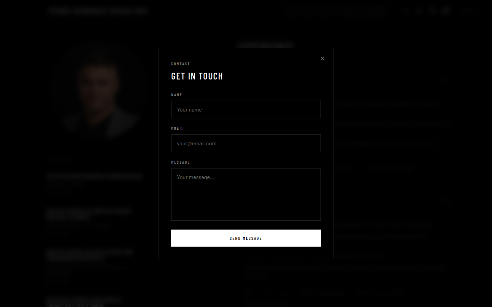

# Contractor Site Design and Reference

Personal resume website showcasing professional experience, portfolio projects, and education.

**Live:** https://phrmoy.com

## Earlier Screenshots

These captures predate the contact and mobile-header repairs. Current verification is linked from `../../evidence_gallery/index.html`; its captures remain in the agent-root temporary folder.

Captured from the production build; sources in `../png/screenshots/`, light theme first, dark theme second.

- Desktop:  
- Mobile:  
- Contact modal:  

## Design

The site shares its design system with the
[rmet-publishing blog](https://rocha-moy-engineering-technology.github.io/rmet-publishing/):
black ground, Barlow Condensed set in uppercase for display type, Barlow for
body copy, hairline rules instead of filled cards, square corners, and no accent
colour. The shared vocabulary lives in `src/app.css` as `display`, `label`,
`icon-link`, `entry`, `entry-title` and `chip`; those class names mean the same
thing on both sites. `action`, the filled primary control of the resume form,
is this site's own and has no counterpart on the blog.

## Features

- Professional experience timeline with role descriptions and technology tags
- Portfolio section highlighting key projects
- Education history
- Downloadable Portable Document Format (PDF) resume
- Contact form powered by [Web3Forms](https://web3forms.com/)
- Responsive two-column layout (desktop) with single-column mobile fallback
- Light and dark themes that follow the visitor's system preference, with a
  navbar toggle whose choice is remembered and applied before first paint

## Tech Stack

- **Framework:** Svelte 5 + Vite
- **Styling:** Tailwind CSS v4
- **Testing:** Vitest units and headless Playwright integration/end-to-end tests, followed by the separate ordered browser smoke project. Set `PLAYWRIGHT_CHROMIUM_PATH` when the installed Google Chrome is unavailable.
- **Deployment:** Cloudflare Pages (project `phrmoy`, custom domain phrmoy.com) via `npm run deploy`, which first runs every check (`npm run validate:all`); there is no Continuous Integration (CI)

## Development

```bash
npm install
npm run dev        # Start dev server
npm run build      # Production build
npm run test       # Run unit tests
npm run test:e2e   # Run headless end-to-end and ordered smoke tests
npm run validate:all # Check formatting, types, lint, units, headless browsers, and build
```

## Links

- [GitHub](https://github.com/phrmoy)
- [LinkedIn](https://www.linkedin.com/in/phrmoy/)
- [Toptal Profile](https://www.toptal.com/developers/resume/pedro-henrique-rocha-moy)
